# Sunibgram — Database Schema & Relationships

> Reference doc for generating ERD visualizations. Source: GORM models in `backend/domain/model/`.
> Conventions: PK = primary key, FK = foreign key, M:N = many-to-many join table, `uint` IDs unless noted.
> A Mermaid `erDiagram` is included at the bottom — paste it into any Mermaid renderer (or Claude) to draw the ERD.

---

## Table Index (by domain)

| Domain | Tables |
|--------|--------|
| User & Auth | `users`, `roles`, `verification_codes`, `user_stats`, `user_faculties` |
| Profile & Settings | `user_profiles`, `user_settings`, `profile_field_changes` |
| Social Graph | `user_relationships`, `user_blocks`, `notification_user_mutes` |
| Content | `threads`, `thread_media`, `thread_polls`, `thread_poll_options`, `thread_poll_votes`, `thread_summaries` |
| Interactions | `likes`, `bookmarks`, `reposts`, `thread_pins` |
| Hashtags | `hashtags`, `thread_hashtags` |
| Events | `events`, `thread_events`, `event_participants`, `event_faculty_locations`, `event_reviews`, `event_pins`, `event_thread_pins`, `event_action_confirmations` |
| Communities | `communities`, `community_members`, `community_rules`, `community_requests`, `community_thread_pins`, `community_pins`, `community_action_confirmations` |
| Community Events | `community_events`, `community_event_invitees`, `community_event_comments`, `community_event_reactions` |
| Chat | `chat_rooms`, `chat_room_members`, `chats`, `chat_media`, `chat_reads`, `chat_reactions` |
| Moderation | `reports`, `violations`, `trend_reports`, `trend_report_reasons` |
| Premium | `premium_subscriptions`, `orders` |
| Bookmarks/Collections | `bookmark_collections`, `bookmark_collection_items` |
| Fox (AI) | `fox_sessions`, `fox_histories` |
| Analytics | `trending_user_snapshots` |
| Lookups | `faculties`, `faculty_locations`, `categories` |
| Feedback | `feedbacks`, `feedback_votes`, `feedback_media` |

---

## 1. User & Auth

### users
PK `user_id`. The central entity — almost everything FKs back to it.

| Column | Type | Key / Notes |
|--------|------|-------------|
| user_id | uint | PK |
| name | string | not null |
| user_name | string | unique, not null (3–30 chars) |
| email | string | unique, not null (@binus.ac.id) |
| password | string | not null (never serialized) |
| role_id | uint | FK → roles.role_id (default 1) |
| is_premium | bool | default false |
| onboarding_completed | bool | default false |
| terms_accepted | bool | default false |
| created_at / updated_at | time | |

**Relations:** FK role_id → roles. 1:1 user_stats, user_profiles, user_settings. M:N user_faculties.

### roles
PK `role_id`. Seeded: `user`, `lecturer`, `admin`.

| Column | Type | Key |
|--------|------|-----|
| role_id | uint | PK |
| name | string | unique, not null |
| created_at / updated_at | time | |

### verification_codes
PK `id`. Email verification / password reset codes.

| Column | Type | Key / Notes |
|--------|------|-------------|
| id | uint | PK |
| email | string | indexed, not null |
| code | string | not null |
| type | varchar(32) | REGISTER / FORGOT_PASSWORD / CHANGE_PASSWORD |
| expires_at | time | not null, indexed |
| used | bool | default false |
| created_at | time | |

### user_stats
PK `user_id` (also FK → users). 1:1 with users.

| Column | Type | Key |
|--------|------|-----|
| user_id | uint | PK, FK → users.user_id |
| follower_count | int | default 0 |
| following_count | int | default 0 |

### user_faculties (M:N users ↔ faculties)
Composite PK `(user_id, faculty_id)`.

| Column | Type | Key |
|--------|------|-----|
| user_id | uint | PK, FK → users.user_id |
| faculty_id | uint | PK, FK → faculties.faculty_id |

---

## 2. Profile & Settings

### user_profiles
PK `profile_id`. 1:1 with users (unique user_id).

| Column | Type | Key / Notes |
|--------|------|-------------|
| profile_id | uint | PK |
| user_id | uint | unique, FK → users.user_id |
| gender | varchar(30) | nullable; CHECK in (male, female, other, prefer_not_to_say) |
| birthday_date | date | nullable |
| avatar_object_name | string | default '' (S3) |
| banner_object_name | string | default '' (S3) |
| bio | text | default '' |
| faculty_location_id | uint | nullable, FK → faculty_locations.id |
| created_at / updated_at | time | |

### user_settings
PK `user_id` (FK → users, ON DELETE CASCADE). 1:1.

| Column | Type | Key / Notes |
|--------|------|-------------|
| user_id | uint | PK, FK → users.user_id |
| is_private | bool | default false |
| user_theme | varchar(20) | default 'black'; CHECK in (black, white) |

### profile_field_changes
PK `id`. Audit log for rate-limited profile edits (name/username 7d, faculty_location 180d cooldown).

| Column | Type | Key / Notes |
|--------|------|-------------|
| id | uint | PK |
| user_id | uint | FK → users.user_id (idx_pfc_user_field) |
| field | varchar(20) | name / username / faculty_location |
| changed_at | time | not null |
| old_value / new_value | varchar(50) | default '' |

---

## 3. Social Graph (self-referential users ↔ users)

### user_relationships (follow graph)
Composite PK `(follower_id, following_id)`.

| Column | Type | Key |
|--------|------|-----|
| follower_id | uint | PK, FK → users.user_id |
| following_id | uint | PK, FK → users.user_id |
| created_at | time | |

### user_blocks (block graph)
Composite PK `(blocker_id, blocked_id)`.

| Column | Type | Key |
|--------|------|-----|
| blocker_id | uint | PK, FK → users.user_id |
| blocked_id | uint | PK, FK → users.user_id |
| created_at | time | |

### notification_user_mutes (one-way mute)
Composite PK `(user_id, muted_user_id)`.

| Column | Type | Key |
|--------|------|-----|
| user_id | uint | PK, FK → users.user_id |
| muted_user_id | uint | PK, FK → users.user_id |
| created_at | time | |

---

## 4. Content

### threads
PK `thread_id`. Core post entity. Self-referential (parent/root/original). POST / REPLY / REPOST.

| Column | Type | Key / Notes |
|--------|------|-------------|
| thread_id | uint | PK |
| user_id | uint | FK → users.user_id |
| community_id | uint | nullable, FK → communities.community_id (NULL = public) |
| type | varchar(10) | POST / REPLY / REPOST (default POST) |
| content | text | not null |
| reply_permission | varchar(16) | EVERYONE / FOLLOWING / MUTUAL |
| parent_id | uint | nullable, FK → threads.thread_id (self) |
| root_id | uint | nullable, FK → threads.thread_id (self) |
| original_thread_id | uint | nullable, FK → threads.thread_id (self, repost) |
| like_count / repost_count / bookmark_count / comment_count / share_count | int | counters, default 0 |
| feed_score | float64 | default 0 |
| created_at / updated_at | time | |

**Relations:** FK user_id, community_id; 3× self-FK; 1:1 thread_polls, thread_summaries; 1:N thread_media; M:N thread_hashtags, thread_events.

### thread_media
PK `media_id`. Max 4 per thread.

| Column | Type | Key |
|--------|------|-----|
| media_id | uint | PK |
| thread_id | uint | FK → threads.thread_id |
| object_name | string | S3 |
| created_at | time | |

### thread_polls
PK `poll_id`. 1:1 with thread (unique thread_id). 2–4 options, 5min–7d.

| Column | Type | Key |
|--------|------|-----|
| poll_id | uint | PK |
| thread_id | uint | unique, FK → threads.thread_id |
| question | text | nullable |
| ends_at | time | not null, indexed |
| total_votes | int | default 0 |
| created_at / updated_at | time | |

### thread_poll_options
PK `option_id`. FK poll_id → thread_polls (CASCADE).

| Column | Type | Key |
|--------|------|-----|
| option_id | uint | PK |
| poll_id | uint | FK → thread_polls.poll_id |
| label | varchar(25) | not null |
| object_name | varchar(500) | nullable (S3) |
| position | int16 | not null |
| vote_count | int | default 0 |
| created_at | time | |

### thread_poll_votes (M:N polls ↔ users)
PK `vote_id`. Unique `(poll_id, user_id)` — one vote per user per poll.

| Column | Type | Key |
|--------|------|-----|
| vote_id | uint | PK |
| poll_id | uint | FK → thread_polls.poll_id (CASCADE) |
| option_id | uint | FK → thread_poll_options.option_id (CASCADE) |
| user_id | uint | FK → users.user_id (CASCADE) |
| created_at | time | |

### thread_summaries
PK `thread_id` (FK → threads). AI-generated, survives edits/deletes.

| Column | Type | Key / Notes |
|--------|------|-------------|
| thread_id | uint | PK, FK → threads.thread_id |
| summary | text | nullable |
| content_snapshot | text | nullable |
| version | int | default 1 |
| is_stale | bool | default false |
| created_at / updated_at | time | |

---

## 5. Interactions (M:N users ↔ threads)

All composite PK `(user_id, thread_id)`.

### likes / bookmarks / reposts / thread_pins
Same shape:

| Column | Type | Key |
|--------|------|-----|
| user_id | uint | PK, FK → users.user_id |
| thread_id | uint | PK, FK → threads.thread_id |
| created_at | time | |

---

## 6. Hashtags

### hashtags
PK `id` (UUID). Counters + weekly counters.

| Column | Type | Key / Notes |
|--------|------|-------------|
| id | uuid | PK |
| name | varchar(255) | unique, lowercase |
| thread_count / like_count / repost_count / share_count | int64 | counters |
| week_thread_count / week_like_count / week_repost_count / week_share_count | int64 | weekly counters |
| created_at | timestamptz | |

### thread_hashtags (M:N threads ↔ hashtags)
Composite PK `(thread_id, hashtag_id)`. Both FKs CASCADE.

| Column | Type | Key |
|--------|------|-----|
| thread_id | uint | PK, FK → threads.thread_id |
| hashtag_id | uuid | PK, FK → hashtags.id |
| created_at | timestamptz | |

---

## 7. Events

### events
PK `id` (varchar(36) UUID). Created by users; approval workflow.

| Column | Type | Key / Notes |
|--------|------|-------------|
| id | varchar(36) | PK (UUID) |
| user_id | uint | FK → users.user_id (creator) |
| title | varchar(255) | not null |
| description | text | nullable |
| location | varchar(255) | nullable |
| type | varchar(20) | official / unofficial |
| status | varchar(20) | pending / approved / rejected |
| start_time / end_time | time | not null, indexed |
| banner_object_name / attachment_object_name | varchar(500) | nullable (S3) |
| docs | jsonb | default '[]' (array of EventDoc) |
| participant_count / thread_count / like_count / repost_count / share_count | int | counters |
| week_* counters | int | weekly |
| created_at / updated_at | time | |

### thread_events (M:N threads ↔ events)
Composite PK `(thread_id, event_id)`. Both FKs CASCADE.

| Column | Type | Key |
|--------|------|-----|
| thread_id | uint | PK, FK → threads.thread_id |
| event_id | varchar(36) | PK, FK → events.id |
| is_official | bool | default false |
| created_at | timestamptz | |

### event_participants (M:N users ↔ events)
Composite PK `(user_id, event_id)`.

| Column | Type | Key |
|--------|------|-----|
| user_id | uint | PK, FK → users.user_id |
| event_id | varchar(36) | PK, FK → events.id |
| joined_at | time | |

### event_faculty_locations (M:N events ↔ faculty_locations)
Composite PK `(event_id, faculty_location_id)`. Both FKs CASCADE.

| Column | Type | Key |
|--------|------|-----|
| event_id | varchar(36) | PK, FK → events.id |
| faculty_location_id | uint | PK, FK → faculty_locations.id |

### event_reviews
PK `id` (UUID). Admin moderation of events.

| Column | Type | Key / Notes |
|--------|------|-------------|
| id | uuid | PK |
| event_id | varchar(36) | FK → events.id (CASCADE) |
| admin_id | uint | FK → users.user_id |
| action | varchar(20) | approve / reject |
| note | text | nullable |
| created_at | timestamptz | |

### event_pins (M:N users ↔ events)
Composite PK `(user_id, event_id)`.

### event_thread_pins
Composite PK `(event_id, thread_id)`. FK → events.id, threads.thread_id.

### event_action_confirmations
PK `id`. Confirmation codes for destructive event actions.

| Column | Type | Key / Notes |
|--------|------|-------------|
| id | uint | PK |
| event_id | varchar(64) | indexed |
| actor_user_id | uint | FK → users.user_id |
| type | varchar(32) | DELETE_EVENT |
| event_title | varchar(200) | snapshot |
| created_at | time | |

---

## 8. Communities

### communities
PK `community_id`. Created/admin'd by a user.

| Column | Type | Key / Notes |
|--------|------|-------------|
| community_id | uint | PK |
| user_id | uint | FK → users.user_id (admin) |
| name | varchar(100) | not null |
| description | text | nullable |
| category_id | uuid | nullable, FK → categories.id (SET NULL) |
| visibility | varchar(10) | PUBLIC / PRIVATE |
| banner_object_name | varchar(500) | nullable (S3) |
| member_count | int | default 1 |
| is_active | bool | default true (soft delete) |
| created_at / updated_at | time | |

### community_members (M:N users ↔ communities)
Composite PK `(community_id, user_id)`. Both FKs CASCADE.

| Column | Type | Key |
|--------|------|-----|
| community_id | uint | PK, FK → communities.community_id |
| user_id | uint | PK, FK → users.user_id |
| role | varchar(12) | MEMBER / ADMIN |
| joined_at | time | |

### community_rules
PK `id`. FK community_id → communities (CASCADE). Unique `(community_id, order_num)`.

| Column | Type | Key |
|--------|------|-----|
| id | uint | PK |
| community_id | uint | FK → communities.community_id |
| order_num | int | unique per community |
| text | varchar(500) | not null |
| created_at / updated_at | time | |

### community_requests (membership workflow)
Composite PK `(community_id, user_id)`.

| Column | Type | Key |
|--------|------|-----|
| community_id | uint | PK, FK → communities.community_id |
| user_id | uint | PK, FK → users.user_id |
| status | varchar(10) | PENDING / APPROVED / DECLINED |
| created_at / updated_at | time | |

### community_thread_pins
Composite PK `(community_id, thread_id)`. FK → communities, threads.

### community_pins (M:N users ↔ communities)
Composite PK `(user_id, community_id)`.

### community_action_confirmations
PK `id`. Confirmation codes for DELETE_COMMUNITY / ADMIN_TRANSFER.

| Column | Type | Key / Notes |
|--------|------|-------------|
| id | uint | PK |
| community_id | uint | indexed |
| actor_user_id | uint | FK → users.user_id |
| target_user_id | uint | nullable (ADMIN_TRANSFER) |
| type | varchar(32) | DELETE_COMMUNITY / ADMIN_TRANSFER |
| community_name | varchar(120) | snapshot |
| created_at | time | |

---

## 9. Community Events

### community_events
PK `id`. Belongs to a community; created by an admin.

| Column | Type | Key / Notes |
|--------|------|-------------|
| id | uint | PK |
| community_id | uint | FK → communities.community_id (CASCADE) |
| created_by_user_id | uint | FK → users.user_id (CASCADE) |
| title | varchar(255) | not null |
| description | text | nullable |
| location | varchar(255) | nullable |
| start_time / end_time | time | not null, indexed |
| banner_object_name | varchar(500) | nullable (S3) |
| pinned_comment_id | uint | nullable → community_event_comments.id |
| comment_count | int | default 0 |
| created_at / updated_at | time | |

### community_event_invitees (M:N users ↔ community_events)
Composite PK `(community_event_id, user_id)`. Both FKs CASCADE. Access control.

### community_event_comments
PK `id`. FK community_event_id (CASCADE), user_id (CASCADE). Supports @mentions.

| Column | Type | Key |
|--------|------|-----|
| id | uint | PK |
| community_event_id | uint | FK → community_events.id |
| user_id | uint | FK → users.user_id |
| content | text | not null |
| created_at / updated_at | time | |

### community_event_reactions (M:N users ↔ community_events)
Composite PK `(community_event_id, user_id)`. One emoji per user (re-pick UPDATEs).

| Column | Type | Key |
|--------|------|-----|
| community_event_id | uint | PK, FK → community_events.id |
| user_id | uint | PK, FK → users.user_id |
| emoji | varchar(32) | not null |
| created_at | time | |

---

## 10. Chat

### chat_rooms
PK `room_id`. DM (private) or group.

| Column | Type | Key / Notes |
|--------|------|-------------|
| room_id | uint | PK |
| name | varchar(100) | nullable (NULL for DM) |
| description | text | nullable |
| avatar_url | varchar(500) | nullable (S3) |
| type | varchar(10) | private / group |
| member_count | int | default 0 |
| encrypted_key | text | nullable |
| created_at / updated_at | time | |

### chat_room_members (M:N users ↔ chat_rooms)
Composite PK `(room_id, user_id)`. Both FKs CASCADE.

| Column | Type | Key |
|--------|------|-----|
| room_id | uint | PK, FK → chat_rooms.room_id |
| user_id | uint | PK, FK → users.user_id |
| joined_at | time | |
| is_muted | bool | default false |

### chats
PK `chat_id`. Self-referential (reply_to). Can share a thread.

| Column | Type | Key / Notes |
|--------|------|-------------|
| chat_id | uint | PK |
| room_id | uint | FK → chat_rooms.room_id |
| sender_id | uint | FK → users.user_id |
| reply_to_id | uint | nullable, FK → chats.chat_id (self) |
| message | text | nullable |
| gif_url | text | nullable (Giphy) |
| shared_thread_id | uint | nullable, FK → threads.thread_id |
| is_read / is_edited | bool | default false |
| edited_at / deleted_at | time | nullable (soft delete) |
| created_at | time | |

### chat_media
PK `media_id`. FK chat_id → chats (CASCADE). Max 4 per message.

| Column | Type | Key / Notes |
|--------|------|-------------|
| media_id | uint | PK |
| chat_id | uint | FK → chats.chat_id |
| object_name | string | S3 (private) |
| media_type | varchar(50) | image/* video/* audio/* |
| file_size | int64 | nullable |
| created_at | time | |

### chat_reads
PK `read_id`. Unique `(chat_id, user_id)`. FK chat_id → chats (CASCADE).

| Column | Type | Key |
|--------|------|-----|
| read_id | uint | PK |
| chat_id | uint | FK → chats.chat_id |
| user_id | uint | FK → users.user_id |
| read_at | time | |

### chat_reactions
PK `reaction_id`. Unique `(chat_id, user_id, emoji)`.

| Column | Type | Key |
|--------|------|-----|
| reaction_id | uint | PK |
| chat_id | uint | FK → chats.chat_id |
| user_id | uint | FK → users.user_id |
| emoji | varchar(32) | not null |
| created_at | time | |

---

## 11. Moderation

### reports
PK `id` (UUID). Reports of users or posts.

| Column | Type | Key / Notes |
|--------|------|-------------|
| id | uuid | PK |
| reporter_id | uint | FK → users.user_id (CASCADE) |
| reported_user_id | uint | nullable, FK → users.user_id (SET NULL) |
| reported_post_id | uint | nullable, FK → threads.thread_id (SET NULL) |
| violation_id | uuid | FK → violations.id (RESTRICT) |
| explanation | text | not null |
| status | varchar(20) | pending / reviewed / resolved / rejected |
| created_at / updated_at | timestamptz | |

### violations
PK `id` (UUID). Seeded lookup of violation types.

| Column | Type | Key |
|--------|------|-----|
| id | uuid | PK |
| name | varchar(100) | unique, not null |
| description | text | not null |
| created_at / updated_at | timestamptz | |

### trend_reports
PK `id` (UUID). Reports against trending hashtags. Unique `(reporter_id, hashtag_id)`.

| Column | Type | Key |
|--------|------|-----|
| id | uuid | PK |
| reporter_id | uint | FK → users.user_id (CASCADE) |
| hashtag_id | uuid | FK → hashtags.id (CASCADE) |
| reason_id | uuid | FK → trend_report_reasons.id (RESTRICT) |
| created_at | timestamptz | |

### trend_report_reasons
PK `id` (UUID). Seeded lookup.

| Column | Type | Key |
|--------|------|-----|
| id | uuid | PK |
| code | varchar(50) | unique (SPAM, MISLEADING…) |
| label | varchar(120) | not null |
| created_at / updated_at | timestamptz | |

---

## 12. Premium

### premium_subscriptions
PK `id` (UUID). FK user_id → users (CASCADE).

| Column | Type | Key |
|--------|------|-----|
| id | uuid | PK |
| user_id | uint | FK → users.user_id |
| is_trial | bool | default false |
| subscription_start_date / subscription_end_date | time | not null |
| created_at / updated_at | time | |

### orders
PK `id`. Payment orders.

| Column | Type | Key / Notes |
|--------|------|-------------|
| id | uint | PK |
| order_id | string | unique (external id) |
| user_id | uint | FK → users.user_id |
| amount | int64 | cents |
| purpose | string | GENERAL / PREMIUM |
| status | string | PENDING / COMPLETED / FAILED / CANCELLED |
| payment_type | string | default '' |
| created_at / updated_at | time | |

---

## 13. Bookmarks / Collections

### bookmark_collections
PK `id`. FK user_id → users (CASCADE). Unique `(user_id, name)`. Max 50/user.

| Column | Type | Key |
|--------|------|-----|
| id | uint | PK |
| user_id | uint | FK → users.user_id |
| name | varchar(50) | unique per user |
| description | text | nullable |
| item_count | int | default 0 |
| created_at / updated_at | time | |

### bookmark_collection_items
Composite PK `(collection_id, user_id, thread_id)`. FK collection_id → bookmark_collections (CASCADE).

| Column | Type | Key |
|--------|------|-----|
| collection_id | uint | PK, FK → bookmark_collections.id |
| user_id | uint | PK, FK → users.user_id |
| thread_id | uint | PK, FK → threads.thread_id |
| created_at | time | |

---

## 14. Fox (AI Assistant)

### fox_sessions
PK `id`. Session header. Partial unique `(user_id, thread_id)` where type='summary'.

| Column | Type | Key / Notes |
|--------|------|-------------|
| id | uint | PK |
| user_id | uint | FK → users.user_id |
| type | varchar(16) | chat / summary |
| thread_id | uint | nullable (summary only) |
| title | text | |
| is_stale | bool | default false |
| created_at / updated_at | time | |

### fox_histories
PK `id`. Entries within a session.

| Column | Type | Key / Notes |
|--------|------|-------------|
| id | uint | PK |
| session_id | uint | FK → fox_sessions.id |
| user_id | uint | FK → users.user_id |
| type | varchar(16) | chat / summary |
| thread_id | uint | nullable |
| question / body / snapshot | text | nullable |
| created_at / updated_at | time | |

---

## 15. Analytics

### trending_user_snapshots
PK `snapshot_id`. Weekly engagement snapshot per user. Unique `(week_start_date, user_id)`.

| Column | Type | Key / Notes |
|--------|------|-------------|
| snapshot_id | uint | PK |
| week_start_date | date | unique w/ user_id |
| user_id | uint | FK → users.user_id |
| rank | int | not null |
| score | float64 | not null |
| likes_in / comments_in / bookmarks_in / reposts_in / thread_count | int | inbound counters |
| likes_out / comments_out / bookmarks_out / posts_out | int | outbound counters |
| snapshot_at | timestamptz | not null |

---

## 16. Lookups

### faculties
PK `faculty_id`. Seeded.

| Column | Type | Key |
|--------|------|-----|
| faculty_id | uint | PK |
| faculty_name | varchar(100) | unique |
| total_users | int | default 0 |

### faculty_locations
PK `id`. Campuses grouped by region. Seeded.

| Column | Type | Key / Notes |
|--------|------|-------------|
| id | uint | PK |
| name | varchar(150) | unique |
| address | varchar(500) | default '' |
| region | varchar(100) | indexed |
| is_all_regions | bool | default false (sentinel) |
| sort_order | int | default 0 |

### categories
PK `id` (UUID). Community categories. Seeded.

| Column | Type | Key |
|--------|------|-----|
| id | uuid | PK |
| name | varchar(100) | unique |
| created_at | timestamptz | |

---

## 17. Feedback

### feedbacks
PK `id` (UUID). FK user_id → users (CASCADE).

| Column | Type | Key / Notes |
|--------|------|-------------|
| id | uuid | PK |
| user_id | uint | FK → users.user_id |
| type | varchar(20) | bug / feature_request |
| title | varchar(200) | not null |
| body | text | not null |
| status | varchar(20) | open / planned / in_progress / resolved / rejected |
| created_at / updated_at | timestamptz | |

### feedback_votes
Composite PK `(feedback_id, user_id)`. One vote per user.

| Column | Type | Key |
|--------|------|-----|
| feedback_id | uuid | PK, FK → feedbacks.id |
| user_id | uint | PK, FK → users.user_id |
| value | smallint | 1 (up) / -1 (down) |
| created_at / updated_at | time | |

### feedback_media
PK `media_id`. FK feedback_id → feedbacks. Max 4.

| Column | Type | Key |
|--------|------|-----|
| media_id | uint | PK |
| feedback_id | uuid | FK → feedbacks.id |
| object_name | string | S3 |
| created_at | time | |

---

## Relationship Summary

**Self-referential**
- `threads` → `threads` (parent_id, root_id, original_thread_id)
- `chats` → `chats` (reply_to_id)
- `users` ↔ `users` via `user_relationships`, `user_blocks`, `notification_user_mutes`

**Many-to-Many join tables**
`user_faculties` (users↔faculties), `thread_hashtags` (threads↔hashtags), `thread_events` (threads↔events), `thread_poll_votes` (polls↔users), `likes`/`bookmarks`/`reposts`/`thread_pins` (users↔threads), `community_members`/`community_pins` (users↔communities), `community_thread_pins` (communities↔threads), `event_participants`/`event_pins` (users↔events), `event_faculty_locations` (events↔faculty_locations), `event_thread_pins` (events↔threads), `community_event_invitees`/`community_event_reactions` (users↔community_events), `chat_room_members` (users↔chat_rooms), `feedback_votes` (users↔feedbacks).

**Check constraints**
- `user_profiles.gender` ∈ {male, female, other, prefer_not_to_say}
- `user_settings.user_theme` ∈ {black, white}

**ON DELETE behavior**
- CASCADE — most child rows
- SET NULL — nullable FKs (`reports.reported_user_id`, `reports.reported_post_id`, `communities.category_id`)
- RESTRICT — lookup tables (`violations`, `trend_report_reasons`)

---

## Mermaid ERD

> Paste into a Mermaid renderer. Crow's-foot notation: `||--o{` = one-to-many, `}o--o{` = many-to-many (via join), `||--||` = one-to-one.

```mermaid
erDiagram
    users ||--o{ threads : "authors"
    users ||--|| user_stats : "has"
    users ||--|| user_profiles : "has"
    users ||--|| user_settings : "has"
    users ||--o{ user_faculties : ""
    faculties ||--o{ user_faculties : ""
    roles ||--o{ users : "role"
    users ||--o{ profile_field_changes : "logs"
    faculty_locations ||--o{ user_profiles : "home campus"

    users ||--o{ user_relationships : "follower"
    users ||--o{ user_relationships : "following"
    users ||--o{ user_blocks : "blocker/blocked"
    users ||--o{ notification_user_mutes : "muter/muted"

    threads ||--o{ threads : "parent/root/original"
    threads ||--o{ thread_media : "has"
    threads ||--|| thread_polls : "has"
    thread_polls ||--o{ thread_poll_options : "has"
    thread_polls ||--o{ thread_poll_votes : "receives"
    thread_poll_options ||--o{ thread_poll_votes : "chosen"
    users ||--o{ thread_poll_votes : "votes"
    threads ||--|| thread_summaries : "summarized"

    users ||--o{ likes : ""
    threads ||--o{ likes : ""
    users ||--o{ bookmarks : ""
    threads ||--o{ bookmarks : ""
    users ||--o{ reposts : ""
    threads ||--o{ reposts : ""
    users ||--o{ thread_pins : ""
    threads ||--o{ thread_pins : ""

    threads ||--o{ thread_hashtags : ""
    hashtags ||--o{ thread_hashtags : ""

    users ||--o{ events : "creates"
    threads ||--o{ thread_events : ""
    events ||--o{ thread_events : ""
    users ||--o{ event_participants : ""
    events ||--o{ event_participants : ""
    events ||--o{ event_faculty_locations : ""
    faculty_locations ||--o{ event_faculty_locations : ""
    events ||--o{ event_reviews : ""
    users ||--o{ event_reviews : "admin"
    users ||--o{ event_pins : ""
    events ||--o{ event_pins : ""
    events ||--o{ event_thread_pins : ""
    threads ||--o{ event_thread_pins : ""

    users ||--o{ communities : "admin"
    categories ||--o{ communities : "category"
    communities ||--o{ community_members : ""
    users ||--o{ community_members : ""
    communities ||--o{ community_rules : ""
    communities ||--o{ community_requests : ""
    users ||--o{ community_requests : ""
    communities ||--o{ community_thread_pins : ""
    threads ||--o{ community_thread_pins : ""
    communities ||--o{ community_pins : ""
    users ||--o{ community_pins : ""
    threads }o--o| communities : "posted in"

    communities ||--o{ community_events : ""
    users ||--o{ community_events : "creator"
    community_events ||--o{ community_event_invitees : ""
    users ||--o{ community_event_invitees : ""
    community_events ||--o{ community_event_comments : ""
    users ||--o{ community_event_comments : ""
    community_events ||--o{ community_event_reactions : ""
    users ||--o{ community_event_reactions : ""

    chat_rooms ||--o{ chat_room_members : ""
    users ||--o{ chat_room_members : ""
    chat_rooms ||--o{ chats : ""
    users ||--o{ chats : "sends"
    chats ||--o{ chats : "reply_to"
    threads ||--o{ chats : "shared"
    chats ||--o{ chat_media : ""
    chats ||--o{ chat_reads : ""
    users ||--o{ chat_reads : ""
    chats ||--o{ chat_reactions : ""
    users ||--o{ chat_reactions : ""

    users ||--o{ reports : "reporter"
    users ||--o{ reports : "reported"
    threads ||--o{ reports : "reported post"
    violations ||--o{ reports : ""
    users ||--o{ trend_reports : ""
    hashtags ||--o{ trend_reports : ""
    trend_report_reasons ||--o{ trend_reports : ""

    users ||--o{ premium_subscriptions : ""
    users ||--o{ orders : ""

    users ||--o{ bookmark_collections : ""
    bookmark_collections ||--o{ bookmark_collection_items : ""
    threads ||--o{ bookmark_collection_items : ""

    users ||--o{ fox_sessions : ""
    fox_sessions ||--o{ fox_histories : ""
    users ||--o{ fox_histories : ""

    users ||--o{ trending_user_snapshots : ""

    users ||--o{ feedbacks : ""
    feedbacks ||--o{ feedback_votes : ""
    users ||--o{ feedback_votes : ""
    feedbacks ||--o{ feedback_media : ""

    users ||--o{ verification_codes : "email"
```

